<div align="center">

<picture>
<source media="(prefers-color-scheme: dark)" srcset="./dark.svg">
<source media="(prefers-color-scheme: light)" srcset="./light.svg">

</picture>

<br/>
<br/>

[](https://www.steelandstack.com)
[](https://warehouse-xi-ten.vercel.app)
[](https://github.com/devansh8011-oss/ai-lab-monitor)
[](https://www.steelcircuits.com)
[](https://instagram.com/devansh999ai)
[](mailto:devansh8011@gmail.com)


</div>

---

### ⚡ Executive Summary

> *"Engineering the future of tech."*

I am **Devansh Grover**, Founder at **[Steel and Stack](https://www.steelandstack.com)** (`steelandstack.com`), student at **DPS Indirapuram (Delhi)**, and a systems builder with 4+ years of hands-on experience bridging high-level web architecture, autonomous robotics hardware, computer vision, and generative AI systems.

- 🏢 **Startup**: **[Steel and Stack](https://www.steelandstack.com)** — Building next-generation digital products, AI automation pipelines, and connected engineering infrastructure.
- 🚀 **Currently Building**: Smart IoT telemetry twins, edge computer vision monitoring systems, and autonomous robotics controllers.
- 🛠️ **Core Specialties**: Full-Stack Development (React 19 / Node.js), Embedded C++ & ROS, Edge Computer Vision (OpenCV / MediaPipe), and Autonomous Systems.
- 📍 **Base**: Delhi, India.

---

### 🛸 Featured Projects & Systems

<table>
  <tr>
    <td width="50%" valign="top">
      <h3 align="center">🏭 Smart Warehouse Monitoring System</h3>
      <p align="center"><b>Interactive IoT Cold-Storage Digital Twin</b></p>
      <p>An interactive, zero-dependency digital-twin and visual simulation for smart agricultural warehouse monitoring. Features top-down multi-zone SVG telemetry, dynamic temperature/humidity climate curves, actuated cooling fan systems, and real-time environmental stress modeling.</p>
      <p align="center">
        <a href="https://warehouse-xi-ten.vercel.app"><b>🚀 Launch Live Demo »</b></a> &#183;
        <a href="https://github.com/devansh8011-oss/smart-warehouse-monitoring-system"><b>📦 Source Code »</b></a>
      </p>
    </td>
    <td width="50%" valign="top">
      <h3 align="center">👁️ AI Lab Monitoring System</h3>
      <p align="center"><b>Computer Vision Edge Attendance &amp; Focus Tracker</b></p>
      <p>An autonomous computer vision system designed for institutional computer labs. Automatically logs student entry and exit with facial recognition, measures individual dwell times, and performs real-time focus vs. distraction analysis—exporting clean CSV telemetry for administrative review.</p>
      <p align="center">
        <a href="https://github.com/devansh8011-oss/ai-lab-monitor"><b>📦 Explore Repository »</b></a>
      </p>
    </td>
  </tr>
  <tr>
    <td width="50%" valign="top">
      <h3 align="center">🍰 CocoaDotts</h3>
      <p align="center"><b>Artisan Bakery Commerce Engine</b></p>
      <p>Custom digital ordering platform and business infrastructure built for a bespoke confectionery and artisan bakery, handling real-time custom cake workflows, tier selections, automated sales pipelines, and customer orders.</p>
      <p align="center">
        <a href="https://www.cocoadotts.com"><b>Visit cocoadotts.com »</b></a>
      </p>
    </td>
    <td width="50%" valign="top">
      <h3 align="center">🏢 Steel and Stack</h3>
      <p align="center"><b>Flagship Tech Innovation Studio</b></p>
      <p>Next-generation tech innovation studio and engineering firm engineering high-performance web applications, automated business pipelines, custom PCB carrier boards, and integrated IoT hardware solutions.</p>
      <p align="center">
        <a href="https://www.steelandstack.com"><b>Visit steelandstack.com »</b></a>
      </p>
    </td>
  </tr>
</table>

---

### 💻 Technical Arsenal

```ini
[CORE_LANGUAGES]       = C++ · Python · JavaScript · TypeScript · HTML5 · CSS3
[FRONTEND_FRAMEWORKS]  = React 19 · Next.js · Tailwind CSS
[BACKEND_RUNTIMES]     = Node.js · Express.js · REST APIs
[ROBOTICS_EMBEDDED]    = ROS (Robot Operating System) · Arduino · ESP32 · Raspberry Pi · KiCad PCB
[COMPUTER_VISION]      = OpenCV · MediaPipe · Real-time Sensor Interfacing
[CLOUD_DATABASES]      = Firebase · Supabase · Google Cloud Platform (GCP) · AWS · Azure
[COMMERCE_AUTOMATION]  = Razorpay Gateway · n8n Automation Engine · Webhooks
[ENGINEERING_TOOLS]    = VS Code · Cursor · Claude Code · Git · GitHub · Linux
```

---

<h2 align="center">📊 GitHub Contributions</h2>

<div align="center">

<picture>
<source media="(prefers-color-scheme: dark)" srcset="https://raw.githubusercontent.com/devansh8011-oss/github-snake/output/github-snake-dark.svg">
<source media="(prefers-color-scheme: light)" srcset="https://raw.githubusercontent.com/devansh8011-oss/github-snake/output/github-snake.svg">

</picture>

</div>

---

### 📡 Terminal Dispatch & Connect

```bash
devansh@steelstack:~$ curl -s https://www.steelandstack.com/connect
```

- 🏢 **Startup / Venture**: [steelandstack.com](https://www.steelandstack.com)
- 🏭 **Smart Warehouse**: [warehouse-xi-ten.vercel.app](https://warehouse-xi-ten.vercel.app)
- 👁️ **AI Lab Monitor**: [github.com/devansh8011-oss/ai-lab-monitor](https://github.com/devansh8011-oss/ai-lab-monitor)
- 🌐 **Portfolio**: [steelcircuits.com](https://www.steelcircuits.com)
- 🐙 **GitHub**: [@devansh8011-oss](https://github.com/devansh8011-oss)
- 📸 **Instagram**: [@devansh999ai](https://instagram.com/devansh999ai)
- 📧 **Direct Email**: [devansh8011@gmail.com](mailto:devansh8011@gmail.com)
- 🏫 **School**: DPS Indirapuram, Delhi
